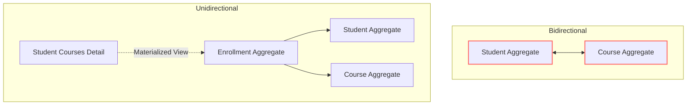
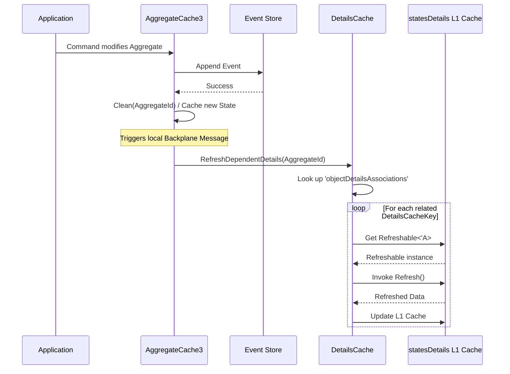
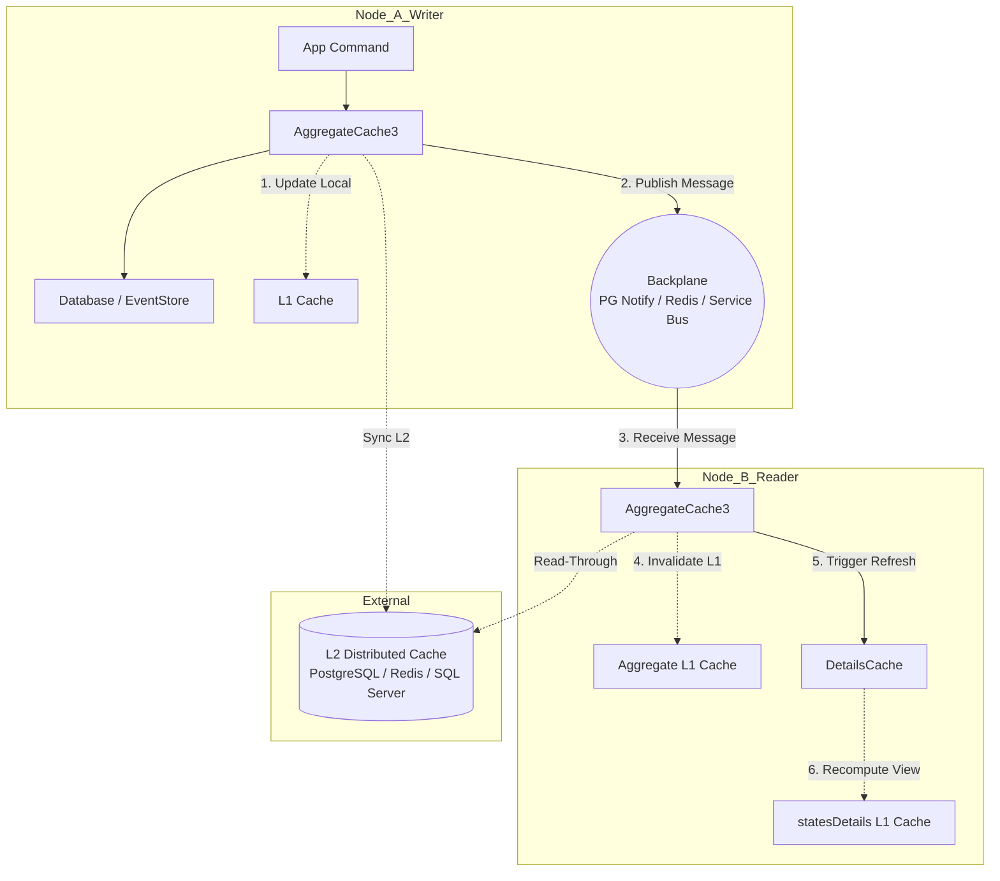

# Caching Architecture: Aggregates, Details, and Backplanes

This document outlines the caching architecture within the Sharpino project, detailing the handling of domain aggregates, materialized read-model views (Details), and the mechanisms used to keep them consistently synchronized across distributed instances utilizing an L2 Cache and a message backplane.

## 1. The Context: Cross-Stream Invariants and Unidirectional Design

In an Event Sourced system where domain events are first-class citizens, a recurring challenge is dealing with cross-stream invariants—rules that span across multiple aggregate streams (e.g., ensuring a bidirectional relationship between `Course` and `Student` remains consistent). Maintaining these invariants purely through distributed transactional events can quickly become complex, expensive, and fragile.

Although many presented examples contain mutual references, it is generally more appropriate to adopt a **unidirectional design approach**. In this approach, instead of enforcing mutual invariants directly between multiple associated aggregates, a single aggregate acts as the source of truth for the relationship. 



However, this simplification imposes a cost on querying and navigation. To efficiently retrieve relational data (e.g., "all courses for a student"), we must rely on **Materialized Views**, referred to in Sharpino as **Details**.

---

## 2. Refreshable Details: Keeping Aggregates and Details in Sync

The relation between Aggregates and their resulting view models (Details) revolves around the concept of **Refreshable Details**. 

A `Detail` is essentially an in-memory materialized view optimized for the read-side. To ensure these views do not drift out of sync when their underlying Aggregates emit new events, they are implemented using the `Refreshable<'A>` or `RefreshableAsync<'A>` interface. 

When a component of a Detail depends on an Aggregate, an association is recorded between the `AggregateId` and the specific `DetailsCacheKey` that represents the materialized view. Whenever the Aggregate produces an event modifying its state, the system reacts by triggering a refresh of all corresponding dependent Details (`RefreshDependentDetails` or `RefreshDependentDetailsAsync`). This localized reactivity guarantees that our high-performance read models are kept consistently synced with the write-side Event Store.

### Refreshable Details Flow

This diagram shows how emitting an event triggers the dependent details to refresh:



---

## 3. Cache for Aggregates (`AggregateCache3`)

Reconstituting an aggregate state from a long stream of events can be costly if done for every command or read request. Sharpino implements an `AggregateCache3` backed by `ZiggyCreatures.FusionCache` to address this:

- **Primary Role:** It memoizes the most recent calculated state of an aggregate (`CachedAggregateEntry`) to dramatically speed up subsequent command evaluations and queries.
- **Dual-Tier Model (`CachedAggregateEntry`)**:
  ```fsharp
  [<CLIMutable>]
  type CachedAggregateEntry = {
      EventId: EventId
      TypeName: string
      StateJson: string
      [<System.Text.Json.Serialization.JsonIgnore>]
      mutable BoxedState: obj option
  }
  ```
  - **L1 Sub-Microsecond Speed:** In-memory hits utilize `BoxedState`, which retains the direct reference to the aggregate object. Reading from L1 bypasses JSON deserialization entirely.
  - **L2 Serializable Persistence:** When written to L2 (PostgreSQL, Redis, or SQL Server), the entry is serialized as JSON (`EventId`, `TypeName`, `StateJson`). When rehydrated from L2 on cold nodes, `BoxedState` is deserialized on-demand.
- **Cache Lifecycle:** State is cached per `AggregateId`. Emitting a new event updates or evicts the cached entry (`Clean`).
- **Distributed Read-Through Acceleration (`StateView`):** When loading snapshots via `StateView.getLastAggregateSnapshot` or `StateView.getLastAggregateSnapshotAsync`, Sharpino first checks `AggregateCache3.Instance.GetEntry / GetEntryAsync`. If present in L1 or L2, the cached snapshot is used immediately, skipping the database snapshot table.

---

## 4. Cache for Details (`DetailsCache`)

The `DetailsCache` is responsible for storing the computed `Refreshable` or `RefreshableAsync` states and navigating the links between Aggregates and Details.

It internally operates two distinct caches:
1. **`statesDetails`:** Stores the actual materialized view objects (wrapped in closures). Notably, because these objects often contain `System.Type` references or active closures that cannot easily be JSON serialized, this cache **intentionally avoids L2 distribution**. It is purely a fast, in-memory Level 1 (L1) cache.
2. **`objectDetailsAssociationsCache`:** Stores the mappings (`List<DetailsCacheKey>`) dependent on any given `AggregateId`. Because this entails simple, serializable data, it is safely persisted in the L2 Distributed Cache, allowing multiple nodes to understand aggregate dependencies.

When `RefreshDependentDetails(aggregateId)` or `RefreshDependentDetailsAsync(aggregateId, ct)` is triggered, the `DetailsCache`:
1. Looks up the association cache to find all `DetailsCacheKey`s bound to the aggregate.
2. Invokes the `Refresh()` mechanism on each corresponding `Refreshable`.
3. If the refresh succeeds, updates the `statesDetails` L1 cache. If it fails (e.g., indicating the referenced data was destroyed), the entry is safely evicted.

---

## 5. Distributed Cache & Backplane Synchronization

To support horizontal scaling, Sharpino instruments its cache layers (using `FusionCache`) with an **L2 Distributed Cache** and a **Backplane**.



### Supported L2 Cache Providers
Sharpino supports multiple distributed cache backends configured via `appSettings.json`:
- **PostgreSQL:** via `Community.Microsoft.Extensions.Caching.PostgreSql` (table `sharpino_l2_cache`).
- **Redis:** via `Microsoft.Extensions.Caching.StackExchangeRedis`.
- **SQL Server / Azure SQL:** via `Microsoft.Extensions.Caching.SqlServer`.

An important operational characteristic defined in the configuration is that the **L2 Time-to-Live (TTL) is strictly shorter than the L1 TTL** (e.g., L2 = 120–600s, L1 = 600s). This design averts situations where stale L2 distributed entries mistakenly pollute fresh L1 caches when application nodes are restarted.

### Supported Backplane Providers
A Backplane is used to broadcast immediate cache mutations across distributed instances:
- **PostgreSQL `LISTEN / NOTIFY`:** channel `sharpino_cache_eviction` (zero external broker dependency).
- **Redis Pub/Sub:** high-throughput distributed pub/sub.
- **Azure Service Bus:** cloud-native enterprise messaging.

### Backplane Synchronization Workflow
1. **Publishing:** When an Aggregate state is evicted (`Clean`) or updated (`Memoize2`), the system broadcasts an `EntryRemove` or `EntrySet` message over the Backplane.
2. **Receiving and Evicting L1:** Other nodes listening to the Backplane receive these messages and react:
   - For `AggregateCache3`: The receiving node evicts its **local L1 memory entry** (`receiverOptions` configured with `SkipDistributedCacheWrite = true` and `SkipDistributedCacheRead = true`), ensuring L2 retains the latest serialized snapshot while the receiving node clears stale in-memory state. Subsequent reads fetch from L2 without hitting the database snapshot table.
   - **Crucially, it also automatically extracts the `AggregateId` and invokes `DetailsCache.Instance.RefreshDependentDetailsAsync(aggregateId, ct)`**.
   - For tests and rolling maintenance, `AggregateCache3.Instance.ClearL1()` flushes local memory without dropping distributed L2 cache.

---

## Summary

Sharpino's caching approach gracefully addresses the unidirectional constraints of strict Event Sourcing. By combining high-speed L1/L2 multi-tier caching (`CachedAggregateEntry`) with reactive `Refreshable` Details, flexible backplane providers (PostgreSQL Notify, Redis Pub/Sub, Azure Service Bus), and read-through snapshot acceleration in `StateView`, it guarantees sub-microsecond in-memory performance alongside robust multi-node consistency.

For high-throughput deployment strategies—including physical read/write DB separation, tenant sharding, and serverless Azure Functions controllers—see the [Scalability, Sharding & Serverless Guide](/advanced/scalability-and-sharding/).
