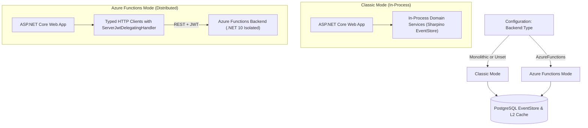
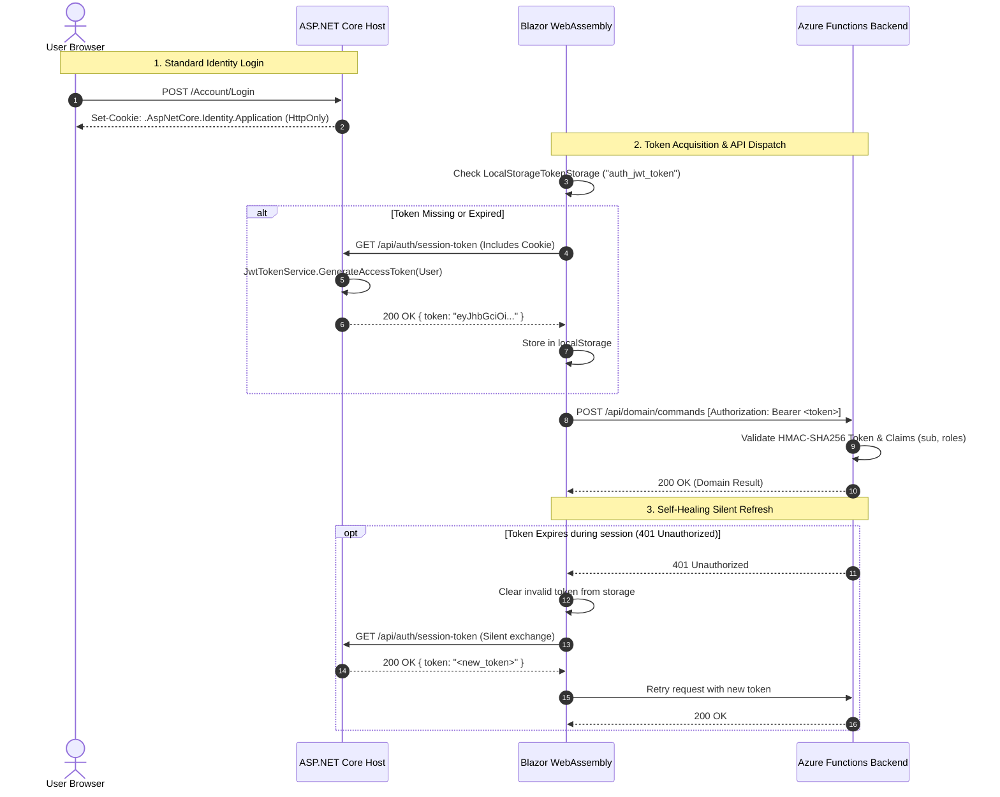

# Tested Deployment: Serverless Dual-Mode Architecture

A production-tested reference architecture demonstrates an optional configuration where **Azure Functions (.NET 10 Isolated Worker)** serve as advanced, auto-scaling controllers for **Sharpino**, paired with a **Blazor WebAssembly** client.

This tested deployment provides:
- **Dual-Mode Deployment:** Seamlessly switching between a classic in-process monolith and a serverless Azure Functions controller tier via simple configuration.
- **Blazor WebAssembly Frontend:** Accessing controller abstractions via HTTP REST with business logic strictly encapsulated on the server.
- **Stateless JWT Security:** Bridging ASP.NET Core Identity session cookies with Azure Functions bearer tokens and silent auto-refresh.
- **Hardware Daemon Agnosticism:** Powering background services and local client daemons through uniform endpoints.
- **Multi-Tier Distributed Caching:** Synchronizing state across serverless nodes using PostgreSQL `LISTEN`/`NOTIFY`.

---

## 1. Dual-Mode Deployment Architecture

The application can toggle between a classic single-process deployment and an auto-scaling serverless topology via a single configuration key (`Backend:Type`):



### Configuration Mechanics

In `Program.cs`, service registration adapts dynamically:

```csharp
var backendType = builder.Configuration["Backend:Type"];

if (string.Equals(backendType, "AzureFunctions", StringComparison.OrdinalIgnoreCase))
{
    // Register HTTP client proxies forwarding domain commands to Azure Functions
    builder.Services.AddHttpClient<IDomainService, ClientDomainService>(client =>
    {
        client.BaseAddress = new Uri(builder.Configuration["Backend:ApiBaseUrl"]!);
    }).AddHttpMessageHandler<ServerJwtDelegatingHandler>();
}
else
{
    // Register in-process Sharpino domain services
    builder.Services.AddScoped<IDomainService, DomainService>();
}
```

---

## 2. Authentication: Session Cookies vs. JWT Bearer Tokens

The only significant operational distinction between monolithic and Azure Functions controller deployments is the **authentication model**:

* **Monolithic Controllers:** Utilize ambient ASP.NET Core Identity cookies (`.AspNetCore.Identity.Application`) scoped to the web host process.
* **Azure Functions Controllers:** Run in a serverless, decoupled environment, relying on stateless **HMAC-SHA256 JWT Bearer Tokens**:



### Key Security Benefits:
- **No Long-Lived Refresh Tokens in Browser:** Trust is anchored exclusively in the `HttpOnly`, `Secure` Identity cookie.
- **Short Lifetime:** Access tokens live for 60 minutes, limiting vulnerability windows.
- **Silent Healing:** Transient 401 errors trigger automatic re-exchange transparently to the user without interrupting the session.

---

## 3. Multi-Tier Distributed Caching

In distributed serverless environments with dynamic scaling, Sharpino synchronizes aggregate states across all nodes:

1. **L1 Memory Cache:** Managed by `AggregateCache3.Instance` on each function worker, yielding sub-microsecond in-memory reads.
2. **L2 PostgreSQL Cache Table (`sharpino_l2_cache`):** Fast hydration of aggregate snapshots on cold function startups without full event replay.
3. **Cluster Invalidation (`PgNotifyBackplane`):** Any write transaction automatically broadcasts an eviction signal via PostgreSQL `LISTEN`/`NOTIFY`, ensuring stale in-memory snapshots are instantly invalidated across all serverless instances.

